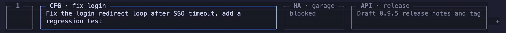

# herdr


<p align="center">
  
</p>

<p align="center">
  <a href="https://herdr.dev">herdr.dev</a> · <a href="#install">install</a> · <a href="https://herdr.dev/docs/quick-start/">quick start</a> · <a href="https://herdr.dev/docs/">docs</a>
</p>

<p align="center">
  English · <a href="README.zh-CN.md">简体中文</a>
</p>

<p align="center">
  <a href="LICENSE"></a>
  <a href="https://github.com/herdrdev/herdr/releases"></a>
  <a href="https://github.com/herdrdev/herdr/stargazers"></a>
  <a href="https://github.com/herdrdev/herdr/releases/latest"></a>
  <a href="https://formulae.brew.sh/formula/herdr"></a>
  <a href="https://x.com/herdrdev"></a>
</p>

---

> [!NOTE]
> **This is [ioanlucut/herdr](https://github.com/ioanlucut/herdr), a personal fork of [herdrdev/herdr](https://github.com/herdrdev/herdr).** It is upstream's latest release plus **card tabs**. Why it exists and what it adds: [issue #1](https://github.com/ioanlucut/herdr/issues/1) · [`FORK.md`](FORK.md). For the real thing, use [herdr.dev](https://herdr.dev).

## this fork: card tabs

**Thank you, [@ogulcancelik](https://github.com/ogulcancelik), [@JJLiebig](https://github.com/JJLiebig), and every Herdr contributor.** Herdr is the best home I have found for many coding agents at once. This fork exists only because I wanted one more thing from the tab bar, and Herdr's clean code made it a small change. All credit for Herdr goes to its maintainers. Bugs in the card tabs are mine: report them [here](https://github.com/ioanlucut/herdr/issues), not upstream.

With many agents in many tabs, I want to see at a glance **which project each tab is, and what its agent works on now**. A stock tab is one row and holds only a label:

<p align="center"></p>

With `tab_style = "card"`, each tab is a bordered card. The project is bold on the top border, and the agent's goal wraps across two rows inside. The focused card gets the accent border:

<p align="center"></p>

Both captures come from the real TUI, driven by the fork's [isolated verification harness](.agents/skills/verify-herdr-fork/SKILL.md).

### what the fork adds

| change | what you get |
|---|---|
| `[ui] tab_style = "card"` | four-row bordered tabs; label on the top border, the part before ` · ` in bold; only the border marks focus |
| `[ui] tab_detail_token = "tldr"` | the card shows that [pane metadata token](https://herdr.dev/docs/socket-api/) from the tab's focused agent, wrapped across two rows; falls back to the status word (`working`, `blocked`, `idle`) |
| `[ui] tab_padding = 2` | cells on each side of a tab label, for both tab styles |
| safe fallbacks | defaults keep upstream behavior; a tab bar too short for four rows keeps line tabs; a tab without an agent keeps an empty card |
| click anywhere on a card | selects its tab, on either content row |
| [`verify-herdr-fork`](.agents/skills/verify-herdr-fork/SKILL.md) | drives the real TUI in a private tmux server and keeps terminal + API evidence for four features: card content, focus and navigation, pane metadata, layout and defaults |
| always current | rebased onto each upstream release tag (now `v0.9.5`), so you lose no upstream fix |

### try it

```toml
# ~/.config/herdr/config.toml
[ui]
tab_style = "card"
tab_padding = 1
tab_detail_token = "tldr"
```

```bash
# from an agent hook, a plugin, or any shell inside a pane
herdr pane report-metadata "$HERDR_PANE_ID" --source my-tool --token "tldr=Fix the login redirect"
```

Build it from source (Rust from `rust-toolchain.toml`, Zig `0.16`):

```bash
git clone -b feat/tab-bar-rows https://github.com/ioanlucut/herdr && cd herdr
ZIG=/path/to/zig-0.16 cargo build --release --locked   # binary: target/release/herdr
```

Stock Herdr warns about the three unknown keys and draws plain tabs, so the same config is safe on both.

---

https://github.com/user-attachments/assets/043ec09f-4bdd-41d5-aee0-8fda6b83e267

**the runtime your coding agents live on.**

- **detach without stopping work** — herdr keeps terminals running in a background server when you close the client or lose your SSH connection. after a server or machine restart, herdr restores the saved layout and can resume supported agent sessions; the original processes do not survive. [session state →](https://herdr.dev/docs/session-state/)
- **several machines, one window** — keep local work and saved ssh machines together, with a combined agent list and independent reconnects. [remote machines →](https://herdr.dev/docs/connecting-machines/)
- **never hunt for the stuck one** — every pane is marked working, blocked, or idle. when an agent stops and needs an answer, herdr says so.
- **agent-native** — agents drive herdr through the cli and socket api: they can spawn panes, prompt each other, and wait until another agent is genuinely blocked. [agent skill →](https://herdr.dev/docs/agent-skill/)
- **runs what you already run** — claude code, codex, cursor, opencode, grok and the rest. herdr doesn't wrap or replace them; it owns their terminals. building an agent? [add herdr support →](https://herdr.dev/docs/add-herdr-support/)
- **keyboard and mouse, both first-class** — tmux-style prefix keys *and* click, drag, split. pick per moment, not per tool.
- **plugins** — extend panes and workflows. [browse the marketplace →](https://herdr.dev/plugins/)
- **one rust binary, no electron** — runs in whatever terminal you already use.

---

## install

```bash
curl -fsSL https://herdr.dev/install.sh | sh
```

or `brew install herdr` · `mise use -g herdr` · windows: `powershell -ExecutionPolicy Bypass -c "irm https://herdr.dev/install.ps1 | iex"` · [endpoint-protected Windows](https://herdr.dev/docs/windows-beta/) · [binaries](https://github.com/herdrdev/herdr/releases)

then start it where the work lives:

```bash
herdr
```

run your agents, split panes, walk away. `ctrl+b q` detaches, `herdr` reattaches. [quick start →](https://herdr.dev/docs/quick-start/)

## docs

everything lives at [herdr.dev/docs](https://herdr.dev/docs/): [quick start](https://herdr.dev/docs/quick-start/) · [concepts](https://herdr.dev/docs/concepts/) · [supported agents](https://herdr.dev/docs/agents/) · [keyboard](https://herdr.dev/docs/keyboard/) · [configuration](https://herdr.dev/docs/configuration/) · [session state](https://herdr.dev/docs/session-state/) · [connecting machines](https://herdr.dev/docs/connecting-machines/) · [remote](https://herdr.dev/docs/persistence-remote/) · [integrations](https://herdr.dev/docs/integrations/) · [add herdr support to your agent](https://herdr.dev/docs/add-herdr-support/) · [plugins](https://herdr.dev/docs/plugins/) · [socket api](https://herdr.dev/docs/socket-api/)

## thanks

every past sponsor and backer is listed in [SPONSORS.md](./SPONSORS.md) — thank you 🐑

enterprise / partnership: hey@herdr.dev

## agent instructions

if you are an ai agent helping with this repository, read [`AGENTS.md`](./AGENTS.md) before making changes and read [`CONTRIBUTING.md`](./CONTRIBUTING.md) before opening issues or PRs.

## development

```bash
git clone https://github.com/herdrdev/herdr
cd herdr
cargo build --release

just test        # unit tests
just check       # formatting, tests, and maintenance checks
```

## license

Herdr is licensed under the [Apache License 2.0](LICENSE).
